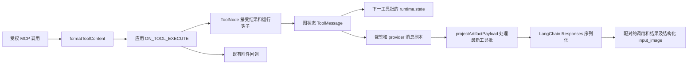

# MCP 工具图片按短引用读回

设计与本地候选 · 2026-11-23

## 建议

首版由 LibreChat 为日常聊天的受权根 Agent 启用 `read_image(ref)`，由 Agents SDK 从同一用户轮、同一次前台执行的原 `ToolMessage.artifact.content` 取图。首次请求沿用现有图片投影，同时给模型可区分的短引用。普通后继工具轮只保留旧图的短引用和必要文本。模型显式选中一张图时，把它作为结构化图片送进紧接该调用的 Responses 请求。每个工具调用和结果继续使用原 `call_id` 配对。

图片的唯一读回来源是当前图状态里的原消息。首版只保留有界的引用和定位信息，原消息离开可用状态时引用过期。目标链路是瑶瑶日常长会话经 NewAPI 使用 `gpt-6.2-sol` 的 OpenAI Responses 请求。小米 9 的 Android Portal 截图用于验收。能力适用于这条链路上已受权的内联 MCP 图片，和具体 MCP 服务器无关。

## 固定基线与证据

| 对象 | 固定版本与证据 |
| --- | --- |
| LibreChat 初版设计基线 | `Ricky-Hao/LibreChat` 的 `design/mcp-image-on-demand` 从 `patches` 的 `ad89c658dd9ff358c38e8a014c8bed16eec3ac09` 开始，包含诊断 PR #20。下文历史源码行号沿用该阶段固定基线。 [补丁清单][manifest] · [PR #20][diagnostic-pr] |
| 初版设计时的生产应用 | 用户给定 LibreChat v0.8.9，上游 `d4e85d2205c78413ee27d631d7e3b7313556f21d` 加该 manifest 的有序补丁。初版用临时 Git 索引重放，得到树 `746b9fbcd6012a993841256c9d02f4b867b96767`，逐项匹配 `/workspaces/librechat-responses-vision-diagnostics/.work/replay-final` 的索引。`/workspaces/librechat-upstream-d4e85d2-agents-v4-2-11-20261119` 是较早的集成快照 `aa1f9fc7e9ef724e79d93a67192b9bff69d85e8f`。以下历史应用行号以完整重放树为准。 [上游提交][app-upstream] · [维护流程](maintenance.md) · [MCP 图片补丁][mcp-patch] |
| 初版设计时的生产 SDK | `@librechat/agents` `4.2.11-ricky.1` 对应 `Ricky-Hao/agents` `06ac16c17bcd7a75e79c01d57248f350b157676b`。重放树的 SDK 归档 SHA-256 为 `90e25b2cb8a000b32c212f6bee091f215323faa8c80955e9d2495d2822a747f1`，与 `vendor/agents.json` 一致。锁定 `@langchain/openai` 1.5.8、`@langchain/core` 1.2.8、LangGraph 1.4.8 和 OpenAI SDK 6.49.0。 [SDK 来源及消费方式][sdk-patch] |
| 提问共存的修复基线 | 用户提供的 rev103 验收对应 LibreChat `a281587f46a7e961bc257c23a859f6e8f28d5551` 与 SDK `4.2.11-ricky.2` 源码 `ca2a2f5532a86e10b5bb1c607864c265a0c11099`。`ask_user_question` 可用时，宿主提前装载 saver，而该 SDK 对带 saver 的执行停用 `read_image`。修复从上述应用维护提交和 Agents 维护提交 `5deda2dc651d4b79ee859ef641a189caa5a4d7b3` 开始。 [本地候选归档及来源][sdk-current] |

**历史实证。** 用户提供的生产长会话中，模型盲读出小米 9 计算器里的随机数 `27252`。截图后再调用文本工具，其后继请求还带原截图调用，图数已为 `0`，`has_previous_response_id=false`。既有 SDK 归档离线评估也观察到配对和原 artifact 仍在，图片只在最新工具批后展开。这些结果来自此前验收。 [诊断字段及其边界][mcp-readme]

**设计阶段离线探针。** 解出生产归档，由进程内 `fetch` 接管合成的 Responses 地址。脚本驱动 `Run.processStream`、事件工具和直接图工具。宿主替身返回一张 9 × 4 PNG（95 字节）及纯文本。直接图工具从 `runtime.state.messages` 取得原块并作为测试 artifact 返回。十组历史输入触发了 provider 视图裁剪，四次请求依次携带 `0 → 1 → 0 → 1` 张图。规范状态仍含原图。两次出站图与输入逐字节相等，调用和结果全程配对，均无 `previous_response_id`。该探针验证了裁剪后的取图路径。

**本地候选。** LibreChat 在原 `mcp-images` 组实现宿主准入及 MCP 来源检查。Agents `4.2.11-ricky.3` 在 `tool-image-read` 组修复了 `4.2.11-ricky.2` 遇到提问 saver 就停用读回的问题。`initializeClient` 到 loopback `/v1/responses` 的合成合同覆盖普通前台提问与读回共存。实际首轮提示可以在图状态之外播种，作用域从新鲜 `processStream` 起算，在本次执行结束、实际暂停或规范消息出现后续用户消息时关闭旧引用。 [宿主合同][mcp-current] · [SDK 本地候选来源][sdk-current]

## 基线怎样传图



1. 聊天入口 `AgentClient.chatCompletion` 在应用 `api/server/controllers/agents/client.js:4541,4825,5033,5175` 构建历史、创建 Run 并调用 `processStream`。`initialize.js:717–727,795–815` 为初始 Agent 注册 MCP 定义。`loadToolsForExecution` 经 `ToolService.js:2460–2500` 和 `handleTools.js:633–664` 用解析后的模型 provider 重载工具，因而自定义端点名 `NewAPI` 不会被误作 MCP 格式化的 provider。`MCP.js:1372–1419,1495–1513` 把受权调用交给 Manager，并为工具实例设置 `content_and_artifact` 和服务端 MCP 绑定。 [初始化及工具装载补丁][mcp-wiring]
2. `packages/api/src/mcp/MCPManager.ts:1523,2175,2289–2304` 处理实际 MCP 响应，将 `isError` 与 `formatToolContent` 结果交回。`parsers.ts:92–142,367–393,463–478,504–511,599–625` 按工具响应顺序收集独立和嵌入图片。对识别的 provider，文本进 `content`，图块进 `artifact.content`，纯图的文本可为空。内联图封装为 `image_url` Data URL，直接使用源 Base64。解析器也有 URL 输入路径。未知 provider 的 `content: []` 和 `imageAttachments` 用于附件回退。能走该格式化分支只代表识别到 provider，最终模型是否支持视觉还须单独确认。 [Manager 与解析器补丁][mcp-format]
3. 应用 `packages/api/src/agents/handlers.ts:5632–5663,7755–7892` 接 SDK 事件，运行前台 `tool.invoke`、执行参数和输出策略，成功后才返回 `content`、`artifact`、状态和原 ID，也在这条路径上触发宿主附件回调。SDK `ToolNode` 处理事件回包和 `PostToolUse` 后才建设对应 `ToolMessage`。直接工具则通过 `invokeWithRuntime` 接收传入工具节点的 `runInput` 作为 `runtime.state`。同一批的直接执行共享入参，direct 和 event 混合时合并顺序与模型的调用列表可能不同。 [事件建消息][s-event] · [直接工具的 state][s-runtime] · [同批调度与合并][s-batch]
4. SDK 的 `createPruneMessages` 给模型节点返回 `context`，`messagesToUse = context`。provider 中间件、工具输出文本投影、格式化和溢出判断再基于该视图工作。规范图消息由 `messagesStateReducer` 维护。`projectArtifactPayload` 要求尾端是 `ToolMessage`，从它找到所属的最后一组 `AIMessage.tool_calls`，并按配对聚合该批的 artifact。它在 provider 副本留下带原 `tool_call_id` 的占位结果并清空副本的 `artifact.content`，在批尾附一个临时多模态 `HumanMessage`。聚合预算或格式化后的上下文预算不够时，SDK 可退回没有该聚合载荷的版本。后续文本工具批不再展开旧图，图状态也不会因此丢失原 artifact。 [裁剪][s-prune] · [根状态][s-root-state] · [批投影][s-project] · [投影及回退][s-budget] · [最终复测][s-final-fit]
5. `@langchain/openai` 1.5.8 的 `dist/converters/responses.cjs:698–721,906–963,1080–1116` 把 Human 图块变成 `input_image`，把真实 `ToolMessage` 变成相同 ID 的 `function_call_output`。在现用消息格式中，普通 `image_url` 数组直接塞进 `ToolMessage.content` 会走 JSON 字符串分支。显式原生 `input_text`、`input_image`、`input_file` 数组有另一条传递分支。`dist/chat_models/responses.cjs:162–191` 交给 OpenAI SDK 发送。服务端 native `computer_call_output` 有专用转换，SDK 的普通 artifact 投影主动跳过它。 [锁定版转换器][lc-converter] · [锁定版发送器][lc-responses] · [SDK 普通投影][s-project]

当前文本引用由 `ToolOutputReferenceRegistry` 处理。`ToolNode` 在直接和事件路径登记合规的文本输出，工具入参中的 `{{tool…}}` 走文本替换，provider 副本可附 `[ref: tool…]` 或 `_ref`。应用 `packages/api/src/agents/run.ts:2952,3333–3335` 只在具备代码环境的 Run 启用此能力。其登记、存续和恢复逻辑都不能使旧图重新进入 `input_image`。 [文本引用语法及登记][s-text-refs] · [文本输出合成][s-direct-results] · [事件登记][s-event] · [provider 文本引用步骤][s-prepare]

## 图片和引用的寿命

| 路径 | 原图和引用的可用性 | 首版处理 |
| --- | --- | --- |
| 同一前台图执行，provider 预算裁剪 | 模型拿到裁过的副本。离线探针确认后续直接工具仍可见原 `ToolMessage`。如果历史输出被裁，模型对该引用的可见性也随之下降。 [裁剪入口][s-prune] · [直接工具入参][s-runtime] | 在当前工具入参中核对原消息及其父调用。模型已知的 ref 在原消息仍可用时可读，不要求源消息继续出现在每份 provider 副本里。 |
| 实际状态替换、自动摘要、手动 compaction | 摘要节点向消息归约器提供 remove-all 和保留尾部，手动 compaction 有向外层传播的路径。原对偶可能在保留尾部，也可能已被删。离线探针只触发 provider 视图裁剪，未真实运行摘要或 compaction。 [摘要更新][s-summary] · [归约器][s-reducer] · [手动压缩][s-manual] | 源调用与结果仍在当前根视图且可验证时可读，删除或替换后 `image_unavailable`。旧 ref 不从摘要重新生成。 |
| 同一工具批并行及乱序完成 | 并行工具读同一入参。实际提交结果、钩子接受状态和投影位置可使用 `tool_call_id` 关联。 [同批调度][s-batch] · [事件建消息][s-event] | 只读上一批已提交并已向模型提供的引用。按模型的 `tool_calls` 顺序处理，不用完成次序决定编号、配额或来源。 |
| 恢复、checkpoint、后台交付 | SDK 的 fresh stream 会 `resetValues`，`Command` resume 跳过重置。HITL 有内存 saver，应用为审批、`ask_user_question`、Event Actor 接 checkpointer。应用 `run.ts:3088–3106` 与 `checkpointer.ts:339–438,630–652,670–713` 显示 durable saver 可序列化整个 checkpoint，保留所有 checkpoint 模式、interrupt 或需恢复的写入可落库。SDK 的 session `serializeMessage` 另有单独格式，保留调用及文本，没列 `artifact`。两者的寿命和内容不能互推。后台 poll 可通过另一次调用交付任务 artifact（应用 `handlers.ts:7075–7195`）。 [Run fresh/resume][s-start] · [SDK saver][s-checkpoint] · [session 序列化][s-session] | 引用和选图意图不写 checkpoint。暂停、恢复、后台和重启之后都关闭这次读回 scope，历史或补投结果不发行引用。仅 SSE 重接时，如果原前台执行仍在运行，scope 仍由该执行持有。 |
| 父子 Agent、分支和新用户轮 | MultiAgentGraph 依分支和 `startIndex` 切分、收集消息。子 Agent 可以独立运行和转发事件。普通聊天会以新的输入重新构造 Run（应用 `client.js:881–888,4825,5033–5077,5175`）。 [MultiAgentGraph 边界][s-multi] · [子 Agent 事件边界][s-child] | 只在根 Agent 的普通前台执行绑定能力。新执行使用空索引。本次执行中的较新 `HumanMessage` 会封住较早的父工具批。 |

推荐直接读取原消息。证据已覆盖常见的短序列和长历史的视图裁剪，真实摘要删源后的需求仍待验收。若将来的目标链路用例明确显示**同一有效前台轮**在必要读回之前常态删除了源消息，而且提前读回也无法满足任务，再评审独立内存保留。届时 owner 必须是该前台 Run 的一次执行，键含执行代次、根 Agent、源 `AIMessage`/call ID 和原图块下标。上限建议收敛到每轮 32 张、编码图字节合计 2 MiB，单张仍受当前入站和有效投影上限约束，超限停止接收。2 MiB 足以容纳四份每份 280,000 字节的目标截图。成功、失败、取消、语义换轮及暂停均释放，checkpoint 不恢复。首版没有这份图片副本。

## `read_image` 合同

### 短引用和来源

只有现用受权 MCP 客户端的结构化结果可以提供来源。解析器记录被收为 `artifact.content` 的内联图块身份。应用在前台 `createToolExecuteHandler` 的正常成功分支绑定原图块、当前调用和 Run。SDK 通过同进程闭包核对这些对象身份，`ToolNode` 只接受通过结果钩子的最终工具消息。策略拒绝、替换为未经证明的块、错误回包、后台交付、PTC、客户端回传及恢复消息均无此资格。

首版只给合规的内联 PNG、JPEG、WebP 发引用。复用现有 Base64 边界检查和 `packages/api/src/files/mime.ts` 的 `sniffImageMimeType` 核对声明 MIME 与文件头。解码只用于校验或诊断，不保存另一份图。URL、文件 ID、附件、UI 数据、用户图片以及文本里的 Data URL 不进入读回。系统不从字符串标记或任意 artifact 形状推导来源。

引用使用 `img_` 加每图独立生成的 12 随机字节的 Base64url 表示，总长 20 个 ASCII 字符。相同源位置在同一次执行中复用同一 ref。不同位置即使字节相同也有各自的 ref。SDK 根执行持有最多 **32 个**已登记位置，按已提交的批次、每批 `AIMessage.tool_calls` 顺序、每条工具结果 `artifact.content` 的图片下标登记。达到上限后图片继续走首次投影，缺少短引用。索引保存原父消息 ID、`tool_call_id`、原块下标、曝光状态及原工具消息的弱引用。图字节仍由规范消息持有。配额在本轮内不循环使用，流退出时清空索引。

模型在原工具输出首次进入请求时看到按来源排列的文本，例如 `Image 1 [img_V7v9K4WL8dY2H1nQ]`。说明放在原 `function_call_output` 的文本副本，保留原 `call_id`，也适用于纯图片结果的占位。编号为该工具原图片顺序，从 1 开始，跳过的图保留原位次。图随本请求送出时，注明在聚合图片中的位次，用于区分并行来源。合格图片首次因预算省略时仍可提供 ref，并标为未随请求送图，允许后续单独选读。普通后继轮在同一输出的 provider 副本继续提供该 ref，提示按需读回。成对历史整体被裁时，这份提示随之消失。只激活在产生已接受工具调用的 provider 请求中实际暴露过的 ref。工具说明引导模型按任务所需选择，避免立即重读已经可见的图。

### 参数和返回

模型以普通函数工具调用 `read_image({"ref":"img_V7v9K4WL8dY2H1nQ"})`，每次恰好选择一张。参数 schema 如下。执行时按同样规则检查原始入参，无类型转换、trim、别名和文本引用展开。

```json
{
  "type": "object",
  "properties": {
    "ref": {
      "type": "string",
      "pattern": "^img_[A-Za-z0-9_-]{16}$",
      "minLength": 20,
      "maxLength": 20
    }
  },
  "required": ["ref"],
  "additionalProperties": false
}
```

查表后还须在工具的 `runtime.state` 找到与索引完全匹配的原父调用、原 `ToolMessage` 和受信图块，确认同一执行、用户轮、根 Agent 及来源资格。源同名、客户端提交的工具输出、工具文本和伪造 artifact 均不能使查询成功。查到图后直接工具只返回短状态，并将选择绑定到该次直接工具结果的进程内身份。当前图提交这条结果后，投影再次从规范状态取出原块，临时放进**这条读回结果**的 provider 副本。当下一个请求的最新工具批仍保有该调用和结果时，图才能进入结构化输入。原图结果保留其历史配对和引用，读回调用也有自己唯一的结果配对。

| 本次工具结果的模型可见文本 | 条件与载荷 |
| --- | --- |
| `image_included (read image N)` | 最终 provider 投影实际附带一张图。`N` 是本批读回图中的位次。命中索引时只记录选择，投影通过预算后才在出站副本写入此状态。 |
| `invalid_ref` | 非法长度、字符、缺失字段、错误类型或附加参数。无图，反馈不回显输入。 |
| `image_unavailable` | 规范格式但未发行、未激活、未知、过期、来源改变、权限或 scope 不符。统一反馈。无图，无回源动作。 |
| `image_omitted` | 有效选择未进入本请求的读回载荷。候选可能耗尽批预算或最终上下文预算，历史读回配对也保留此短状态。 |

如果模型再次调用同一有效 ref，每次成功读回都重新送图，并按当次请求计入字符和视觉预算。同一并行批的成功读回也逐次计预算，即使引用相同。只在该批投影，文本工具或普通用户消息继续运行时旧图退出请求。历史读回结果仍配对，文本仅说明本请求未重带图片。`read_image` 产出的短状态不登记为可展开引用，读回的临时图也无来源资格。引用始终指向原结果，读回工具不会建第二级引用。一次调用重试使用同一选择和调用结果。传输层重试可以再次发送同一载荷，可能重复消耗请求成本。取消沿已有 abort，丢弃迟到结果和 scope，不再发起读回请求。

### 原字节与预算

原图指 MCP 当次返回的已编码图片。首发和读回使用同一段 `image_url` 数据、同一图像 MIME、同一宽高和同一编码字节，安全复制局部消息时也复用原块内容。两条路径都沿用现有 vision `detail` 处理，不重编、缩放、裁剪、经 CDN 取图或将 Base64 拼入文本。模型或代理对输入的解码及缩放另由真机验收覆盖。

| 限制 | 设计使用方式 |
| --- | --- |
| 入站大小 | 应用 `parsers.ts:20,64–104` 的默认 `MCP_IMAGE_DATA_MAX_BYTES` 为 10 MiB，按 Base64 长度和填充估算编码字节。用户提供的 Android Portal 默认 70,000、最大 280,000 编码字节，按规范 Base64 分别是 93,336、373,336 个字符，另加 Data URL 前缀和序列化开销。视觉 token 仍待实测。 |
| SDK 工具结果和投影字符 | 当前 `Graph` 优先取 `agentContext.maxToolResultChars`，默认 `calculateMaxToolResultChars` 取上下文的 30% × 4 与 400,000 的较小值。累加器会检查整块空间。例如 128,000 上下文 token 对应 153,600 字符的默认投影预算，单张 280,000 编码字节就可能装不下。`toolContent` 的 1,000,000 字符工作限和 5,000,000 全量工具输出硬限有各自用途，现用图批受前述预算。 [Graph 预算入口][s-budget-entry] · [字符上限][s-limits] · [工作限][s-work-limit] |
| 模型上下文 | 复用现有 provider 测量，包含视觉估算、消息、工具 schema 和格式化后的剩余上下文。`estimateImageBlockTokens` 的结果是估计，NewAPI/模型实际使用和计费仍待实测。 [图像估算][s-image-tokens] · [最终复测][s-final-fit] |

在 provider 请求中先为系统/用户内容和完整工具配对保留基线容量。最新批的正常图片先使用图预算。引用说明整体超出上下文余量时，保留原投影并省略该说明。显式读回按模型调用顺序使用同一投影余量和最终上下文。每个 provider 请求最多附 **4 张读回图**。候选图按整块接纳，放不下时保留该调用配对和 `image_omitted`，继续考虑后面的候选。配置了 fallback 的执行起始即停用工具。实际 provider 拒收时沿用原错误处理。四张整图可由模型在同一用户轮按 ref 分步读回，前一读取批的图不会跟随下一批。 [批聚合和配对][s-project] · [回退模型的独立投影][s-fallback]

## 接线、兼容与回滚

| 责任 | 源码落点和建议 |
| --- | --- |
| LibreChat 准入 | `packages/data-provider/src/config.ts` 的 `agentsEndpointSchema` 接受可选布尔开关 `endpoints.agents.mcpImageRead`，缺省关闭。`AgentClient.runAgents` 传前台资格，`packages/api/src/agents/run.ts:createRun` 在标准图上按 `NewAPI`、`gpt-6.2-sol` 传入来源检查。普通前台只因可用的 `ask_user_question` 接入 saver 时，宿主显式允许读回。一般审批、恢复、调度、后台和只做摘要的执行仍关闭读回，SDK 随后核对实际 API 模式。 [宿主实现及使用说明][mcp-current] |
| LibreChat 来源 | `packages/api/src/mcp/parsers.ts:formatToolContent` 记录内联来源。`packages/api/src/agents/handlers.ts:createToolExecuteHandler` 在普通成功分支提供本次结果的服务端证明。沿用现有事件装载、MCP 鉴权和输出策略。 [原格式化落点][mcp-format] |
| Agents SDK 执行 | `src/run.ts` 检查真实 provider、Responses、续接、fallback、持久恢复、审批、委托、追踪配置及同名工具。通过后使用 `graphTools` 绑定 `src/tools/imageRead.ts` 中的工具。`src/tools/ToolNode.ts` 接受最终事件结果，直接图工具从 `runtime.state.messages` 查证原消息。`Run.processStream` 管理索引的启动及释放。 [Run 入口][s-start] · [执行入参][s-runtime] · [模型绑定][s-bind] |
| Agents SDK provider 副本 | `src/messages/core.ts:projectArtifactPayload` 提供最新批的图位置和剩余字符。`src/graphs/Graph.ts` 与 `src/llm/prepareProviderRequest.ts` 在已有裁剪和工具配对之后测量引用及选中图。正常工具结果及读回结果继续使用原 `call_id`。`read_image` 在规范状态和运行事件中只有短文本结果，真正图块由最后的出站副本承载。 [原投影][s-project] · [原预算][s-budget] |

应用 `callbacks.js:976–1010,1342–1366` 的 `getImageAttachmentContent` 会让原 MCP 图进入 `saveBase64Image`。`api/server/services/Files/process.js:1688–1720` 可能重编码并上传到既有文件存储或 CDN。UI 看到的附件字节不一定是模型收到的字节。读回工具不产出图像 artifact、附件、文件记录或新资源 URL，原展示仍由既有路径负责。App 的后台和 PTC 走独立工具表或结果链路，例如 `packages/api/src/agents/ptc.ts:39–111,246–259` 和 `handlers.ts:7723–7743`。`read_image` 通过 `graphTools` 暴露给本次模型调用，既不加入 PTC `toolMap`，也不开放给任何 `allowed_callers` 或客户端路由。原生 Responses 工具，以及 Chat Completions、Anthropic、Google、未知 provider 的既有投影和附件回退由原路径负责。 [附件路径来源][mcp-readme] · [SDK 模型绑定][s-bind]

现有诊断 `packages/api/src/endpoints/openai/config.ts:91–177` 与 `utils/imageDiagnostics.ts:6–119` 用原 MCP、出站请求和尝试字段比对图数、位置、MIME、尺寸及编码字节指纹。它受 debug 门控，每边界最多记录最后四图，`input_image_omitted_count` 表示逐图诊断抽样缺口。首版复用这些计数和现有字段白名单，合成测试在内存直接比字节。若需要新增计数，使用发放、请求、包含和预算省略数量配合已有请求 ID，避免采集完整引用或正文。诊断的 HTTP 尝试与模型 usage 在不同层，需另验模型能否读到图片。 [诊断合同][mcp-readme]

新增图片只沿已获准的结构化 provider 路径传输，选图位置保存在根图索引。带提问 saver 时，收到的 `read_image` 参数仅关联到本次执行的模型响应对象。规范消息及流式工具事件保留工具名和调用 ID，参数为空。选图结果在规范状态为短文本，实际发送图块和新发引用在投影时生成。普通执行过程中保留原 MCP 工具消息的身份，序列化恢复没有该证明，不能用旧 checkpoint artifact 恢复读回作用域。原始 MCP artifact 沿用现有持久化语义。配置了已知 SDK Langfuse 或 LangSmith/LangChain 模型追踪时停用能力。 [SDK trace 脱敏][s-trace] · [HTTP 摘要实现][mcp-http]

实施按三步走。先在 SDK 做根执行引用、状态取图和投影合同，验证全部配对与预算回退。再在应用通过一个关闭态开关接通来源证明和 `graphTools`，从真实聊天入口验证权限及无额外图片副作用。最后才在单一目标路由受权开通并做像素验收。源 SDK 在 `Ricky-Hao/agents` 维护，应用随后更新 vendored SDK 和补丁接线，按现有 manifest 流程在生成 checkout 验证。回滚时移除该可选配置即可使新 Run 停止发引用和绑定工具。需立即停用时取消仍在运行的已启用执行，较大回退使用既有镜像版本，引用无迁移。 [SDK 消费方式][sdk-patch] · [补丁验证与发布](maintenance.md)

## 验收计划

应用合同扩展了 `api/server/services/Endpoints/agents/mcpImages.spec.js` 的 `initializeClient` → `AgentClient.chatCompletion` → vendored SDK → loopback Responses 入口。它用脚本化 SSE 决定调用，模拟 MCP 提供合成 PNG。SDK 合同以独立夹具覆盖多图身份、并行结果、状态删除及预算。下表包含完整验收条件，未在本地完成的部分见后文。 [基线入口测试][mcp-test] · [当前组合同][mcp-current]

| 用例 | 验收条件 |
| --- | --- |
| 真入口单图、文本工具、再选图 | 触发请求 0 图，截图后 1 图且 ref 可见，文本工具后 0 图且原 ref 可在存续的输出中看到，显式工具后恰有选中的 1 图。再跟文本工具时回到 0。两次发送的编码字节与源 PNG 逐字节相等，MIME、宽高和测试解码像素相同。每份请求对保留的所有 `function_call` 有唯一同 ID 的 `function_call_output`，验证无孤儿、无重复，原图、文本和读回的 ID 各自独立。检查最终出站体及 `previous_response_id` 的目标路径行为。 |
| 新用户轮和跨 scope | 同一会话发普通新用户轮，首个请求无旧图。尝试上一轮、其他会话和父子 Agent 的 ref 均无图且无查库/文件动作。提交 steer、取消后仍到达的结果、审批恢复和后台交付无法继承旧引用。 |
| 前台提问和恢复 | 同时暴露提问和读回，前台没有实际提问时照常读图。实际提问与待选图同批时优先暂停。用真实 saver 检查暂停内容，并分别恢复同一个 SDK Run 和重建的 AgentClient，确认问答配对与结果、无暂停前图片、无新增持久引用或读回图块。 |
| 畸形和伪造 | 测空值、数组、附加参数、尾换行、URL、无效字符和随机同形串。伪造来源字段、相同 `tool_call_id`、客户端消息/历史和被策略过滤的工具输出无法登记或读回。关开关、不兼容模式及工具名冲突无可用 `read_image`，反馈不回显输入。 |
| 多图、并行和重读 | 两个并行源各多图，反转完成顺序，编号及预算仍遵循模型调用和原图次序。要求选非首张并逐字节匹配该图，证明未误取同批其他图。再次读同一 ref 送原字节且不给新 ref。覆盖同批新捕获和旧图读回、两次选同一图和超过四张，未选的旧图片都缺席。 |
| 预算、重试和状态退化 | 覆盖单图刚好装下和超出、并行累计、最终格式化超量、路由回退、可读 ref 上限 32、首次省略后单独读回、可读历史被 provider 裁掉和规范消息实际删除。普通原图保持基线优先级，短状态与最终图片一致。合成 429/中断验证重试仍配对且取消不会再投影。 |
| 展示与观测 | 原附件照常。选图不再调用图片保存入口，无新附件或图片持久写入。捕获合成的 trace、checkpoint 输入和日志出口，确认新增图片及完整 ref 不外泄到日志/trace，诊断和终态的图数相符。检查功能关闭和现有 native/PTC 路由。 |

### `4.2.11-ricky.3` 的提问回归

- 前台通过 `initializeClient` 和 `AgentClient` 自动装载 `LazyMongoSaver`，使用本地临时 `mongod`。两个工具同时可见，回环 Responses 图数为 `0 → 1 → 0 → 1 → 0`，两次 PNG 数据和 MIME 一致，调用及输出 ID 配对。另开用户轮时旧引用失效。 [宿主合同][mcp-current]
- 实际触发提问暂停，分别通过原 SDK Run 的 `Command` 和已重建的 AgentClient 恢复。回答进入后继请求，同批待执行的读回没有发送图像。`put`、`putWrites` 和读回的暂停 checkpoint 中均未出现完整 ref 或已投影的图片状态。含原图的 saver 输入只在原 MCP 消息的 artifact 中携带该 PNG。 [宿主合同][mcp-current]

### `4.2.11-ricky.2` 的历史本地验证

- LibreChat 从固定应用基线重放 25 份活动补丁，按锁文件安装候选 SDK。`mcp-images` 及依赖组的 focused 合同通过 535 项测试，覆盖真实入口的回环序列、PNG 原字节和 MIME、下一用户轮的失效、停用和其他 provider 的原路径。读回未增加图片保存调用，合成的工具完成事件、响应内容与所捕获的日志未携带新增图片。 [宿主合同][mcp-current]
- SDK 在候选源码上通过 `tool-image-read` 定向合同的 833 项测试和 trace/Langfuse 相关的 219 项测试。图层夹具验证了实际删源、伪造结果、跨 scope、并行多图及预算。随包源码补丁从固定 SDK 上游重现候选源码树，打包后核对了 ESM 和 CJS 的实际导出。 [候选源码与归档][sdk-current]
- SDK 通过源码类型检查和 8 项类型合同。应用的 `packages/api` 和 `packages/data-provider` 均通过 `tsc --noEmit`，应用受影响的默认静态检查通过。

### 真机验收，留待受权部署后

1. 在同一主长会话保持 NewAPI / `gpt-6.2-sol` / Responses。小米 9 计算器使用新随机数字，测试者在模型输入之外记录答案。给模型一个需要在截图、纯文本工具和最终回答之间回看细节的任务，提示中避开数字和 ref，由模型决定工具调用。要求首次看图时不说出待验数字，后续经过与数字无关的文本工具后，模型需要像素时自行选择 `read_image` 并读出精确数字。记录实际的 `1 → 0 → 1` 和 ID 配对，并与测试者答案比较。为排除首次已读记忆，在同一受权验收中再做一组有不同随机码的多图对照，使用预算边界确保目标图首发确实省略、ref 可见，确认选择后才首次获得目标像素。
2. 仍在该长会话，另一个用户轮内让模型获得四张不同的小红书整图。由测试者在提示外记录每帧独有的细节和一处小字，包含容易混淆的相邻帧。要求模型按语义自行选非首帧和后续帧，在文本工具后主动读回需要的图，逐一报出对应小字和整图特征。可以分次选读以适应实际预算。检查每个选中 ref 都对应预期原帧，整图宽高未变。普通后继无旧图，错误 ref 的对照不能得到目标像素。
3. 在同一长会话继续到模型历史实际裁剪。先在同轮中确认普通后继不携带旧图，并区分仅 provider 视图裁剪和摘要已删除原消息的结果。再开普通新用户轮验证没有之前的工具图，旧 ref 即使被模型尝试也不可用。HTTP 200、同 SHA-256、附件可见和状态里有 artifact 都只能验证各自的边界。通过标准是模型主动选对图及读对提示之外的像素。

## 尚待确认

- 目标长会话的实际选图成功率、首发预算、四帧整图的小字质量及 provider 可能的下采样。先按现有预算验收。若最大编码图单张也常态无法进入请求，再独立评审预算修复，避免用已测编码字节推测实际视觉成本。
- 真实摘要和手动压缩、连续 steer、后台、审批恢复、子 Agent 与另外的 native/PTC 产品入口未跑按需读回用例。
- 现有应用诊断合同覆盖 429、中断和取消。带读回图的传输重试与取消、JPEG/WebP 出站像素、浏览器附件展示、生产数据库与跨副本恢复、自定义 exporter 和生产 trace 尚待验收。本次修复尚未接入真实 NewAPI、模型或小米 9。

## 方案比较与上游边界

| 方案 | 结论 |
| --- | --- |
| SDK 同轮读回，LibreChat 准入及信任接线 | 推荐。SDK 持有真实 `runtime.state`、模型工具绑定、图像预算及最终配对。宿主有权限和 MCP 来源事实。普通回合沿常规历史发送，旧图开销只在明确选读时发生。 |
| 只在 LibreChat 实现读回工具 | 普通 `ON_TOOL_EXECUTE` handler 收到批次和配置，缺少直接工具的规范 `runtime.state`。从回调接管字节需要另管生存期，直接返回可展示 artifact 还可能走附件保存。应用负责授权及注入，SDK 负责读图和投影。 [宿主与状态边界][s-runtime] · [事件流程][s-event] |
| Responses 原生数组 | LibreChat-AI/agents #666 的审阅 head `9c1569ce4084ce588220deff6951aa605d66156b` 在 `_convertMessagesToOpenAIResponsesParams` 和内容标准化代码中将合规文本、图、文件变成同一个 `function_call_output.output` 数组，保留 ID、大小限制、非法块拒绝和 JSON 回退，测试覆盖流式和非流式。它可作为兼容性明确后的投影选择，仍需独立做权限、寿命和预算。首版沿已有 `role=user` 图块路径，NewAPI 对原生数组的实际像素支持待证。 [#666 固定转换代码][pr666] · [OpenAI 函数返回协议][openai-guidance] |
| 自动回放旧图 | #609 评估 head `6c1e81cb91e6b734162740c1d066f19170c76261` 从同一用户轮找已完成的配对。扣除最新工具批预算后，优先给较新的旧图分配余量。模型不用选图，普通工具后继仍会消耗视觉上下文。用户已选择显式读回。 [#609 固定投影代码][pr609] |

两项上游预算差异直接影响本设计的上限判断。#675 head `f0c0b6b8d946fedd8b352f6757607808decd6bef` 修复内联图 Data URL 在 1,000,000 字符工作限内的重复遍历，采用有界长度预留，仍受调用方预算约束。#677 head `6b56c651060b9ca2a211b6387e0c473bcdbe75c1` 为 OpenAI/Google 最新批以及 Anthropic 每工具结果分离文本和图字符预算，图上限使用 5,000,000 字符，最终上下文测量依然生效。这两份改动用于识别性能和限额风险，生产归档仍按上文固定实现核算。 [#675 固定实现][pr675] · [#677 固定实现][pr677]

[manifest]: https://github.com/Ricky-Hao/LibreChat/blob/ad89c658dd9ff358c38e8a014c8bed16eec3ac09/manifest.json#L530-L554
[diagnostic-pr]: https://github.com/Ricky-Hao/LibreChat/pull/20
[app-upstream]: https://github.com/LibreChat-AI/LibreChat/commit/d4e85d2205c78413ee27d631d7e3b7313556f21d
[mcp-patch]: https://github.com/Ricky-Hao/LibreChat/blob/ad89c658dd9ff358c38e8a014c8bed16eec3ac09/patches/mcp-images/changes.patch
[mcp-wiring]: https://github.com/Ricky-Hao/LibreChat/blob/ad89c658dd9ff358c38e8a014c8bed16eec3ac09/patches/mcp-images/changes.patch#L47-L103
[mcp-format]: https://github.com/Ricky-Hao/LibreChat/blob/ad89c658dd9ff358c38e8a014c8bed16eec3ac09/patches/mcp-images/changes.patch#L1481-L1853
[mcp-http]: https://github.com/Ricky-Hao/LibreChat/blob/ad89c658dd9ff358c38e8a014c8bed16eec3ac09/patches/mcp-images/changes.patch#L1230-L1480
[mcp-test]: https://github.com/Ricky-Hao/LibreChat/blob/ad89c658dd9ff358c38e8a014c8bed16eec3ac09/patches/mcp-images/changes.patch#L104-L976
[mcp-readme]: https://github.com/Ricky-Hao/LibreChat/blob/ad89c658dd9ff358c38e8a014c8bed16eec3ac09/patches/mcp-images/README.md#L17-L53
[sdk-patch]: https://github.com/Ricky-Hao/LibreChat/blob/ad89c658dd9ff358c38e8a014c8bed16eec3ac09/patches/sdk/README.md
[mcp-current]: ../patches/mcp-images/README.md
[sdk-current]: ../patches/sdk/README.md
[s-runtime]: https://github.com/Ricky-Hao/agents/blob/06ac16c17bcd7a75e79c01d57248f350b157676b/src/tools/ToolNode.ts#L1726-L1772
[s-direct-results]: https://github.com/Ricky-Hao/agents/blob/06ac16c17bcd7a75e79c01d57248f350b157676b/src/tools/ToolNode.ts#L2113-L2174
[s-event]: https://github.com/Ricky-Hao/agents/blob/06ac16c17bcd7a75e79c01d57248f350b157676b/src/tools/ToolNode.ts#L4775-L4848
[s-batch]: https://github.com/Ricky-Hao/agents/blob/06ac16c17bcd7a75e79c01d57248f350b157676b/src/tools/ToolNode.ts#L6050-L6116
[s-prune]: https://github.com/Ricky-Hao/agents/blob/06ac16c17bcd7a75e79c01d57248f350b157676b/src/graphs/Graph.ts#L3426-L3516
[s-root-state]: https://github.com/Ricky-Hao/agents/blob/06ac16c17bcd7a75e79c01d57248f350b157676b/src/graphs/Graph.ts#L5924-L5968
[s-budget-entry]: https://github.com/Ricky-Hao/agents/blob/06ac16c17bcd7a75e79c01d57248f350b157676b/src/graphs/Graph.ts#L3685-L3710
[s-budget]: https://github.com/Ricky-Hao/agents/blob/06ac16c17bcd7a75e79c01d57248f350b157676b/src/graphs/Graph.ts#L3945-L4071
[s-final-fit]: https://github.com/Ricky-Hao/agents/blob/06ac16c17bcd7a75e79c01d57248f350b157676b/src/graphs/Graph.ts#L4222-L4253
[s-fallback]: https://github.com/Ricky-Hao/agents/blob/06ac16c17bcd7a75e79c01d57248f350b157676b/src/graphs/Graph.ts#L4700-L4815
[s-project]: https://github.com/Ricky-Hao/agents/blob/06ac16c17bcd7a75e79c01d57248f350b157676b/src/messages/core.ts#L2620-L2720
[s-text-refs]: https://github.com/Ricky-Hao/agents/blob/06ac16c17bcd7a75e79c01d57248f350b157676b/src/tools/toolOutputReferences.ts#L685-L878
[s-prepare]: https://github.com/Ricky-Hao/agents/blob/06ac16c17bcd7a75e79c01d57248f350b157676b/src/llm/prepareProviderRequest.ts#L541-L583
[s-summary]: https://github.com/Ricky-Hao/agents/blob/06ac16c17bcd7a75e79c01d57248f350b157676b/src/summarization/node.ts#L2127-L2153
[s-reducer]: https://github.com/Ricky-Hao/agents/blob/06ac16c17bcd7a75e79c01d57248f350b157676b/src/messages/reducer.ts
[s-manual]: https://github.com/Ricky-Hao/agents/blob/06ac16c17bcd7a75e79c01d57248f350b157676b/src/graphs/Graph.ts#L1710-L1731
[s-start]: https://github.com/Ricky-Hao/agents/blob/06ac16c17bcd7a75e79c01d57248f350b157676b/src/run.ts#L1348-L1442
[s-checkpoint]: https://github.com/Ricky-Hao/agents/blob/06ac16c17bcd7a75e79c01d57248f350b157676b/src/run.ts#L796-L820
[s-session]: https://github.com/Ricky-Hao/agents/blob/06ac16c17bcd7a75e79c01d57248f350b157676b/src/session/messageSerialization.ts#L105-L145
[s-multi]: https://github.com/Ricky-Hao/agents/blob/06ac16c17bcd7a75e79c01d57248f350b157676b/src/graphs/MultiAgentGraph.ts#L1798-L1864
[s-child]: https://github.com/Ricky-Hao/agents/blob/06ac16c17bcd7a75e79c01d57248f350b157676b/src/tools/subagent/SubagentExecutor.ts#L3268-L3306
[s-graph-tools]: https://github.com/Ricky-Hao/agents/blob/06ac16c17bcd7a75e79c01d57248f350b157676b/src/types/graph.ts#L1089-L1106
[s-bind]: https://github.com/Ricky-Hao/agents/blob/06ac16c17bcd7a75e79c01d57248f350b157676b/src/graphs/Graph.ts#L2950-L3078
[s-trace]: https://github.com/Ricky-Hao/agents/blob/06ac16c17bcd7a75e79c01d57248f350b157676b/src/langfuseToolOutputTracing.ts#L830-L935
[s-limits]: https://github.com/Ricky-Hao/agents/blob/06ac16c17bcd7a75e79c01d57248f350b157676b/src/utils/truncation.ts#L24-L59
[s-work-limit]: https://github.com/Ricky-Hao/agents/blob/06ac16c17bcd7a75e79c01d57248f350b157676b/src/utils/toolContent.ts#L54-L74
[s-image-tokens]: https://github.com/Ricky-Hao/agents/blob/06ac16c17bcd7a75e79c01d57248f350b157676b/src/utils/tokens.ts#L233-L303
[lc-converter]: https://unpkg.com/@langchain/openai@1.5.8/dist/converters/responses.cjs
[lc-responses]: https://unpkg.com/@langchain/openai@1.5.8/dist/chat_models/responses.cjs
[pr609]: https://github.com/LibreChat-AI/agents/blob/6c1e81cb91e6b734162740c1d066f19170c76261/src/messages/core.ts#L2718-L2822
[pr666]: https://github.com/LibreChat-AI/agents/blob/9c1569ce4084ce588220deff6951aa605d66156b/src/llm/openai/utils/index.ts#L645-L675
[pr675]: https://github.com/LibreChat-AI/agents/blob/f0c0b6b8d946fedd8b352f6757607808decd6bef/src/utils/toolContent.ts#L104-L137
[pr677]: https://github.com/LibreChat-AI/agents/blob/6b56c651060b9ca2a211b6387e0c473bcdbe75c1/src/messages/core.ts#L529-L648
[openai-guidance]: https://developers.openai.com/api/docs/guides/function-calling
